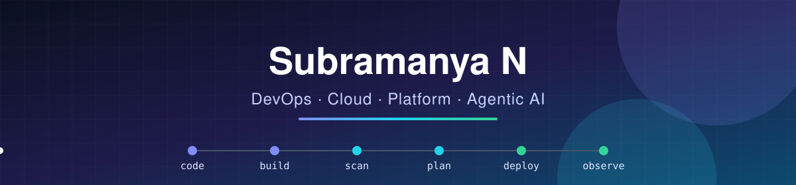

<p align="center">
  
</p>

<p align="center">
  <a href="https://github.com/N-Subramanya">
    
  </a>
</p>

<p align="center">
  
  <a href="https://github.com/N-Subramanya?tab=followers"></a>
</p>

---

## 👋 About Me

```yaml
name: Subramanya N
role: DevOps & Cloud Engineer
focus:
  - CI/CD with Azure DevOps & GitHub Actions
  - Infrastructure as Code with Terraform (Azure + AWS)
  - Containers & Kubernetes
  - AIOps & Agentic AI for operations
currently_building: terraform-ado-multicloud
open_to: collaborating on DevOps / Cloud learning and teaching
```

## 🧰 Tech Stack

<p align="center">
  <br>
  
</p>

<p align="center">
  
  
  
  
  
  
  
</p>

## 🎯 What I Work On

<table>
  <tr>
    <td width="25%" valign="top">
      <h3>⚙️ CI/CD</h3>
      Multi-stage YAML pipelines in Azure DevOps and GitHub Actions, with templates, environments and approval gates.
    </td>
    <td width="25%" valign="top">
      <h3>🏗️ IaC</h3>
      Modular Terraform for Azure and AWS, with remote state, golden images built with Packer, and policy-as-code scanning.
    </td>
    <td width="25%" valign="top">
      <h3>☸️ Kubernetes</h3>
      AKS, Helm, GitOps with Argo CD, autoscaling and observability with Prometheus and Grafana.
    </td>
    <td width="25%" valign="top">
      <h3>🤖 AIOps</h3>
      LLM agents that triage alerts, read logs and metrics, and suggest fixes for operations teams.
    </td>
  </tr>
</table>

## 🚀 Featured Projects

<table>
  <tr>
    <td width="50%" valign="top">
      <h3><a href="https://github.com/N-Subramanya/terraform-ado-multicloud">☁️ terraform-ado-multicloud</a></h3>
      <p>Multi-cloud IaC (Azure + AWS) delivered through Azure DevOps multi-stage pipelines:
      <b>validate → scan → plan → approve → apply</b>, with keyless auth (workload identity federation / OIDC).</p>
      <p>
        
        
        
        
      </p>
      
    </td>
    <td width="50%" valign="top">
      <h3>☸️ k8s-gitops-platform</h3>
      <p>GitOps platform on Kubernetes: Helm charts, Argo CD app-of-apps, Prometheus, Grafana and Loki, plus an autoscaling demo app.</p>
      <p>
        
        
        
      </p>
      
    </td>
  </tr>
  <tr>
    <td width="50%" valign="top">
      <h3>🤖 aiops-incident-agent</h3>
      <p>An agentic AI on-call assistant. It takes Alertmanager alerts, gathers metrics and Kubernetes logs, explains the likely root cause, and proposes a runbook fix.</p>
      <p>
        
        
        
      </p>
      
    </td>
    <td width="50%" valign="top">
      <h3>🛡️ devsecops-ci-cd</h3>
      <p>End-to-end DevSecOps pipeline: Docker build, Trivy and SonarQube scans, push to ACR, and deploy to AKS.</p>
      <p>
        
        
        
      </p>
      
    </td>
  </tr>
</table>

## 🐍 Contribution Activity

<p align="center">
  <picture>
    <source media="(prefers-color-scheme: dark)" srcset="https://raw.githubusercontent.com/N-Subramanya/N-Subramanya/output/github-snake-dark.svg">
    
  </picture>
</p>

---

<p align="center">
  <i>Always learning, always automating.</i> ⭐ Star a repo if it helps you!
</p>
